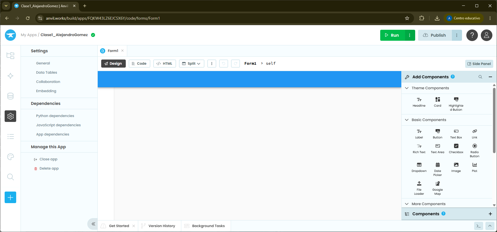
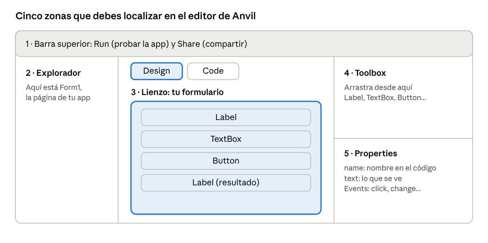
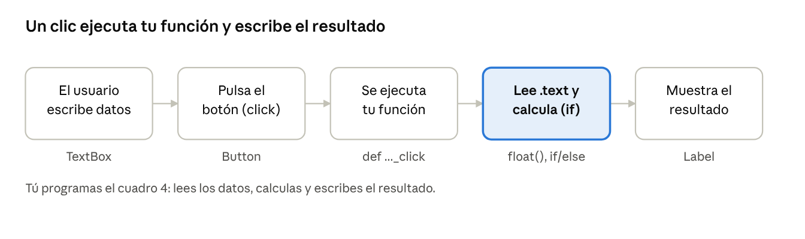
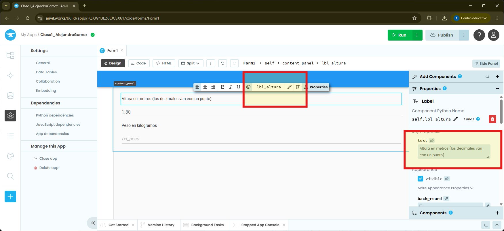
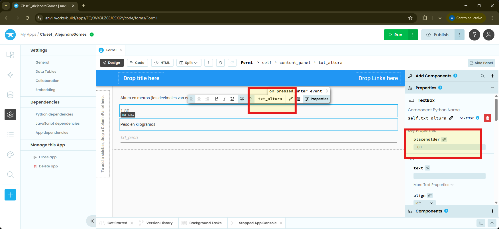
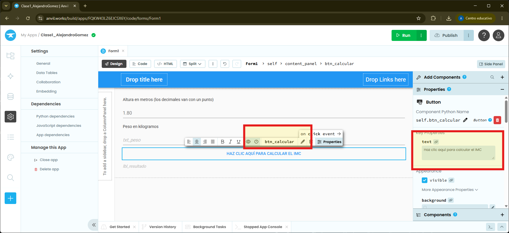
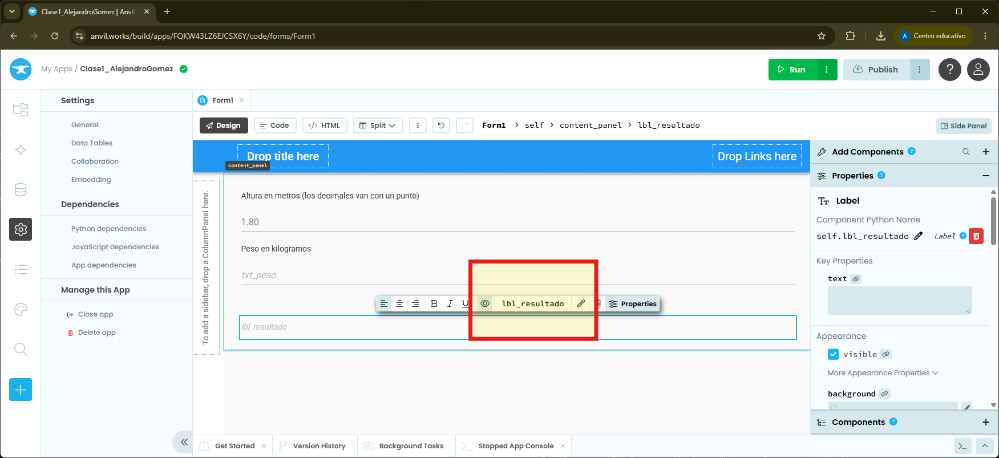
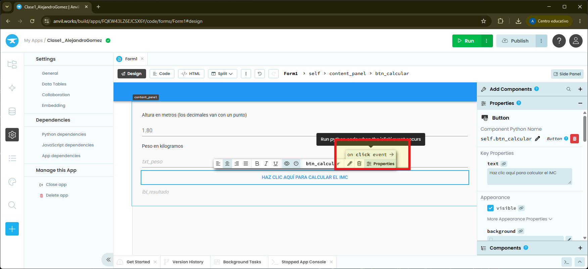
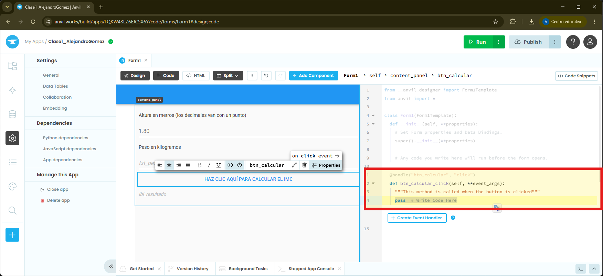
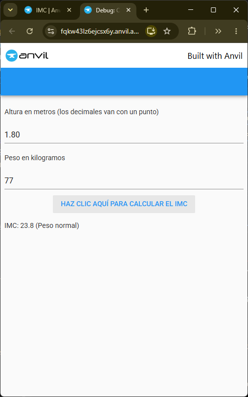

# Introducción a Anvil

[Anvil.works](https://anvil.works/) permite crear una aplicación web programando solo en Python: el diseño se hace arrastrando componentes y la lógica se escribe en Python. En estas clases usaremos el código del formulario, que se ejecuta en el navegador.

## 1. Crear la primera app

1. Entra en [anvil.works](https://anvil.works/) e inicia sesión (o crea una cuenta gratuita).
2. Pulsa **Create App**, elige **Blank App** y el tema **Material Design**.
3. Cambia el nombre de la app, arriba a la izquierda, por **IMC_NombreApellido** (por ejemplo, Clase1\_PepeGarcia).
4. Se abre **Form1**, la página de tu app. Ya puedes diseñarla.

Deberías ver algo como lo siguiente:



Los menús de Anvil cambian de vez en cuando: si una opción no está donde dicen estos apuntes, búscala por su nombre en inglés.

### Las zonas del editor

Cada formulario tiene dos vistas: **Design** (se dibuja arrastrando componentes) y **Code** (se escribe el Python). El botón **Run** abre tu app para probarla.



### Componentes que usaremos

| Componente | Para qué sirve | Propiedades clave |
| --- | --- | --- |
| Label | Mostrar un texto o un resultado | text |
| TextBox | Pedir un dato al usuario | text, placeholder |
| Button | Ejecutar código al pulsarlo | text, evento click |
| DropDown | Elegir una opción de una lista | items, selected\_value |
| TextArea | Mostrar o escribir varias líneas | text, enabled |

### Tres reglas que usaremos siempre

- Dale a cada componente un **nombre claro** en Properties, con un prefijo: `txt_` para TextBox, `btn_` para Button, `lbl_` para Label, `drop_` para DropDown (`txt_peso`, `btn_calcular`, `lbl_resultado`).
- En el código, un componente siempre se escribe con `self.` delante: `self.txt_peso.text`.
- Un TextBox siempre devuelve **texto** (str). Para calcular hay que convertirlo con `int()` o `float()`.

!!! warning "Hacer referencia a componentes en el código"
    Un componente siempre se escribe con `self.` delante: `self.txt_peso.text`.

### Cómo funciona un formulario



Un formulario no ejecuta nada hasta que ocurre un **evento**. Nosotros programamos la función que responde al evento *click* del botón.

## 2. Mi primer programa: calculadora de IMC

### Crear el formulario con el diseñador

1. Arrastra al formulario un Label y un TextBox por cada dato, un Button y un Label para el resultado.
2. En Properties, ponles nombre (`lbl_peso`, `txt_peso`, `lbl_altura`, `txt_altura`, `btn_calcular`, `lbl_resultado`) y cambia el `text` del botón a "Calcular".
3. Selecciona el botón, busca la sección **Events** en Properties y pulsa la flecha junto a **click**. Anvil te lleva a **Code** y escribe la función vacía.
4. Escribe dentro de la función lo que debe pasar.
5. Pulsa **Run** y pruébala.







### Crear el código que se ejecuta al pulsar el botón `btn_calcular`

Tenemos que hacer que cuando se pulse el botón *Calcular el IMC* realmente se calcule utilizando código python. Para esto tenemos que crear un evento. Mira la siguiente imagen.



Fíjate que se abre la ventana del código (`Code`) y tenemos una función (la línea que empieza por `def` y las siguientes indentadas) que es lo que se ejecuta cuando el botón se pulsa.



Vamos a poner el siguiente código.


```python
  @handle("btn_calcular", "click")
  def btn_calcular_click(self, **event_args):
    if self.txt_peso.text == "" or self.txt_altura.text == "":
      alert("Rellena todos los campos")
    else:
      peso = float(self.txt_peso.text)
      altura = float(self.txt_altura.text)
      imc = peso / (altura ** 2)

      if imc < 18.5:
        categoria = "Bajo peso"
      elif imc < 25:
        categoria = "Peso normal"
      else:
        categoria = "Sobrepeso"

      self.lbl_resultado.text = f"IMC: {round(imc, 1)} ({categoria})"
```

- `alert("...")` muestra una ventana emergente al usuario.
- `return` sale de la función y evita seguir calculando con datos vacíos.
- `elif` significa "si no, y si...": se usa para encadenar más de dos casos.
- `f"...{variable}..."` mete el valor de una variable dentro de un texto.

### Errores frecuentes

- `ValueError`: el TextBox está vacío o has escrito la coma decimal. Usa punto: 1.75.
- `AttributeError`: el nombre del componente en el código no coincide con el de Properties.
- `IndentationError`: el código dentro de la función o del `if` no está sangrado.
- No pasa nada al pulsar: la función no está conectada al evento. Vuelve a Properties, Events, click.

### Ejecutar la aplicación

Ejecutamos la aplicación haciendo clic en el botón verde que dice `Run`.



## 3. Enviar la aplicación

Para enviar la aplicación al profesor por Classroom tenemos que hacer lo siguiente:

- Hacemos clic en el botón que está arriba a la izquierda que dice `Publish`.
- Después hacemos clic en el botón que dice `Publish this app`.
- Copiamos la URL donde se ha publicado la aplicación.
- Nos vamos a Classroom y entregamos ahí un enlace.

Por ejemplo, tienes disponible [la aplicación de este ejemplo aquí](https://uniform-piercing-name.anvil.app).