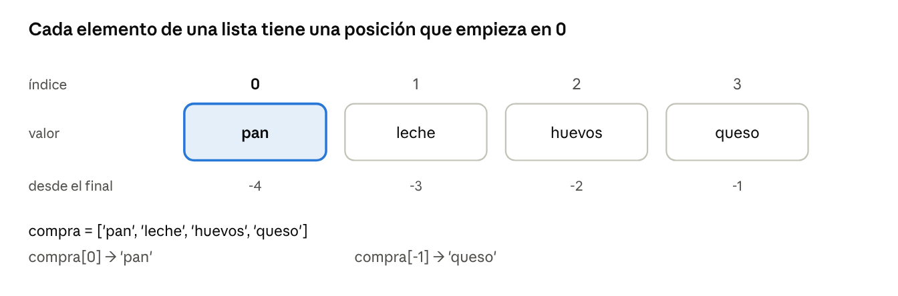
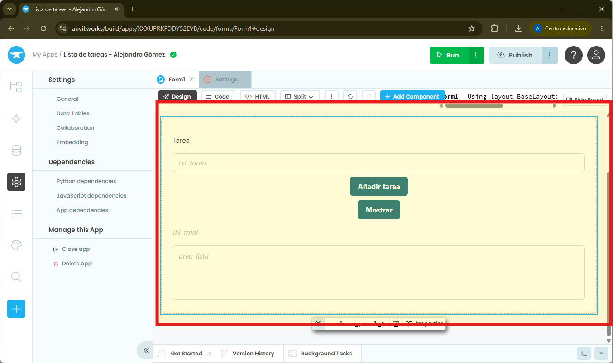
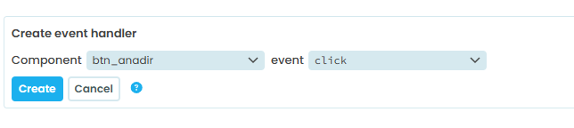
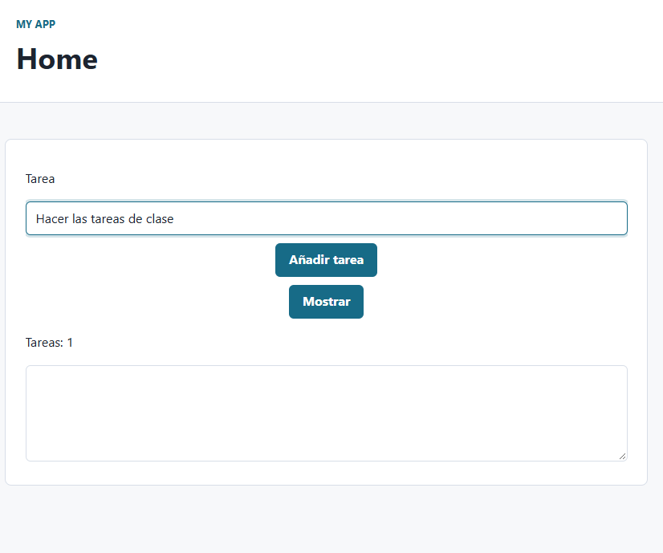

# Listas en python

Una lista guarda varios valores en orden y se puede modificar: es la estructura para colecciones que crecen o cambian, como una lista de la compra.

## 1. Teoría



```python
compra = ["pan", "leche", "huevos"]   # crear una lista
compra[0]                          # "pan" (primer elemento)
compra[-1]                         # "huevos" (último elemento)
len(compra)                        # 3 (cuántos elementos hay)
```

| Operación | Qué hace | Ejemplo |
| --- | --- | --- |
| `append(x)` | Añade al final | `compra.append("queso")` |
| `insert(i, x)` | Inserta en la posición i | `compra.insert(0, "agua")` |
| `remove(x)` | Borra la primera aparición de x (da error si no está) | `compra.remove("pan")` |
| `pop()` | Borra y devuelve el último | `ultimo = compra.pop()` |
| `x in lista` | Comprueba si x está | `"pan" in compra` |
| `index(x)` | Posición de x | `compra.index("leche")` |
| `sorted(lista)` | Devuelve una lista ordenada nueva | `sorted(compra)` |
| `sort()` | Ordena la propia lista | `compra.sort()` |
| `sum`, `min`, `max` | Suma, menor y mayor de una lista de números | `max(notas)` |
| `clear()` | Vacía la lista | `compra.clear()` |

Para recorrer una lista con número de orden:

```python
for i, producto in enumerate(compra):
  texto += f"{i+1}. {producto}\n"
```

## 2. Listas en Anvil

- Una lista que debe recordarse entre pulsaciones de botones se guarda como atributo del formulario: `self.tareas = []`, dentro de `__init__`, después de `self.init_components(**properties)`.
- Un DropDown muestra una lista directamente: `self.drop_tareas.items = self.tareas`.
- Para mostrar varias líneas, usa un TextArea con la casilla `enabled` desmarcada y escribe en su `.text`. El salto de línea se escribe `\n`.

## 3. Ejemplo guiado: lista de tareas

Vamos a crear un nuevo proyecto con AnvilWorks llamado `Lista de tareas - Nombre Apellidos`.

Componentes: `lbl_tarea`, `txt_tarea`, `btn_anadir`, `btn_mostrar`, `lbl_total` y `area_lista` (TextArea).



Pulsamos sobre el botón `Code` y escribimos el siguiente código. Sustituye todo el código que hay por este.

```python
from ._anvil_designer import Form1Template
from anvil import *

class Form1(Form1Template):
  def __init__(self, **properties):
    self.init_components(**properties)
    self.tareas = []

  def btn_anadir_click(self, **event_args):
    if self.txt_tarea.text == "":
      alert("Escribe una tarea")
    else:
      self.tareas.append(self.txt_tarea.text)
      self.txt_tarea.text = ""
      self.lbl_total.text = f"Tareas: {len(self.tareas)}"

  def btn_mostrar_click(self, **event_args):
    texto = ""

    for i, tarea in enumerate(self.tareas, start=1):
      texto += f"{i}. {tarea}\n" # El \n del final es para añadir una línea nueva

    self.area_lista.text = texto

```

Y ahora asocia las funciones anteriores con el evento clic de cada botón. Se puede hacer directamente en la vista del código mediante el botón *Create event handler* que está al final como puedes ver en la siguiente imagen:



Repite el paso anterior asociando el componente *btn_mostrar* con el evento *click*.

## 4. Ejecución de la aplicación

Ejecuta la aplicación e inserta varias tareas. Verás que cada tarea insertada aumenta automáticamente el contador.



Y cuando quieras ver las tareas puedes pulsar el botón *Mostrar*.


