# 🗄️ Adaptación de Base de Datos en Mermaid (11 Proyectos)

Este documento traduce el modelo de base de datos genérico de **6 tablas** (`USUARIO`, `RECURSO_SERVICIO`, `ELEMENTO_DISPONIBLE`, `RESERVA_COMPRA`, `DETALLE_RESERVA`, `PAGO_CONFIRMACION`) a los nombres de entidades y atributos específicos de cada uno de los 11 proyectos mediante diagramas **Mermaid ER**.

---

## 🎬 1. Venta de Entradas de Cine

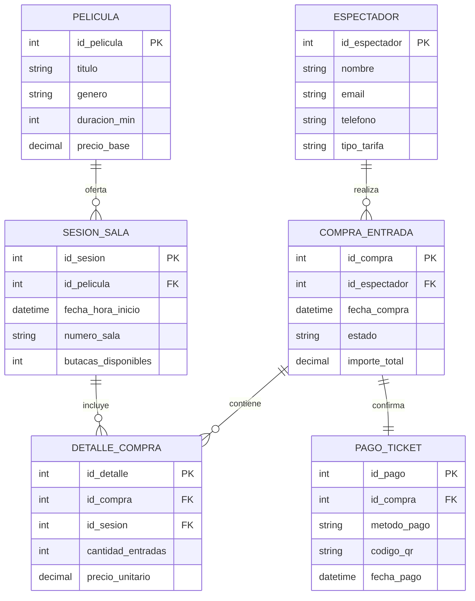

---

## ✂️ 2. Peluquería / Barbería

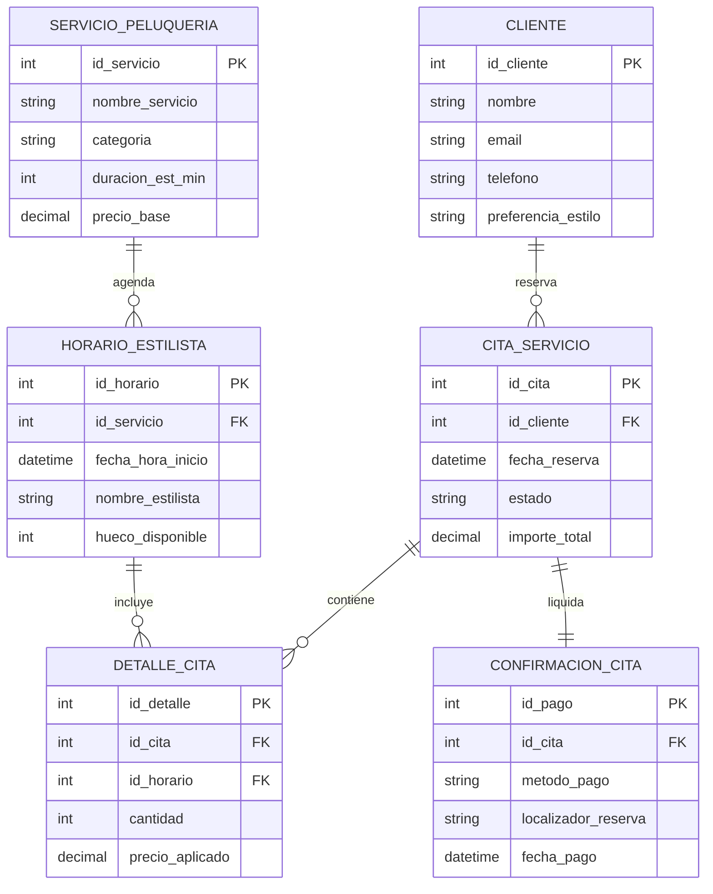

---

## 🍕 3. Pizzería / Restaurante Local

```mermaid
erDiagram
    CLIENTE ||--o{ COMANDA_PEDIDO : realiza
    CLIENTE {
        int id_cliente PK
        string nombre
        string email
        string telefono
        string direccion_envio
    }

    PLATO_PIZZA ||--o{ TURNO_COCINA : programa
    PLATO_PIZZA {
        int id_plato PK
        string nombre_plato
        string categoria_menu
        string alergenos
        decimal precio_base
    }

    TURNO_COCINA ||--o{ DETALLE_PEDIDO : despacha
    TURNO_COCINA {
        int id_turno PK
        int id_plato FK
        datetime hora_entrega_estimada
        string id_horno_franja
        int capacidad_restante
    }

    COMANDA_PEDIDO ||--o{ DETALLE_PEDIDO : contiene
    COMANDA_PEDIDO ||--|| PAGO_COMANDA : liquida
    COMANDA_PEDIDO {
        int id_pedido PK
        int id_cliente FK
        datetime fecha_hora_pedido
        string estado
        decimal importe_total
    }

    DETALLE_PEDIDO {
        int id_detalle PK
        int id_pedido FK
        int id_turno FK
        int cantidad
        decimal precio_unitario
    }

    PAGO_COMANDA {
        int id_pago PK
        int id_pedido FK
        string metodo_pago
        string codigo_ticket_qr
        datetime fecha_pago
    }
```

---

## 🚌 4. Venta de Billetes de Autobús / Tren

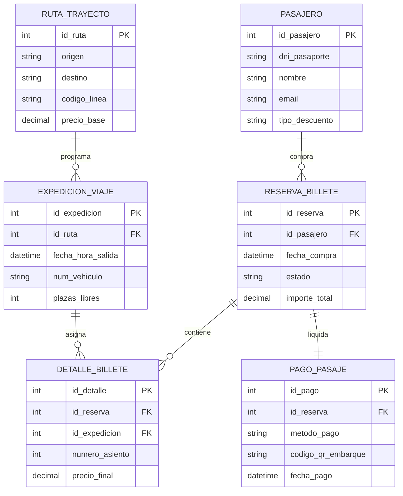

---

## 🎾 5. Reserva de Pistas de Pádel / Club Deportivo

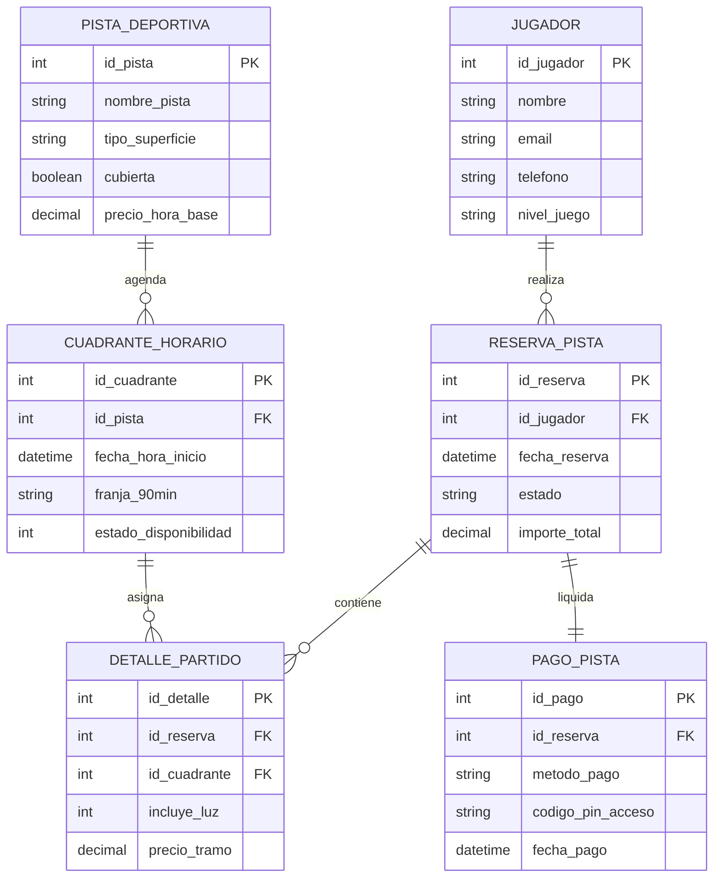

---

## 🩺 6. Clínica Veterinaria / Centro Médico

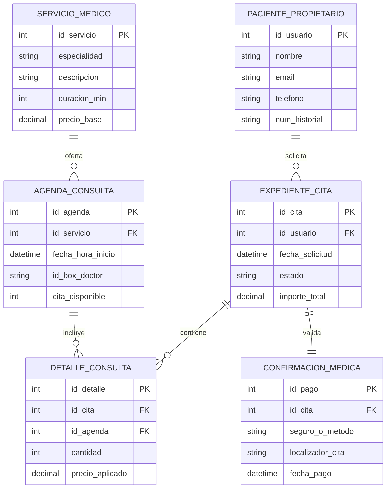

---

## 🎸 7. Entradas para Festivales de Música

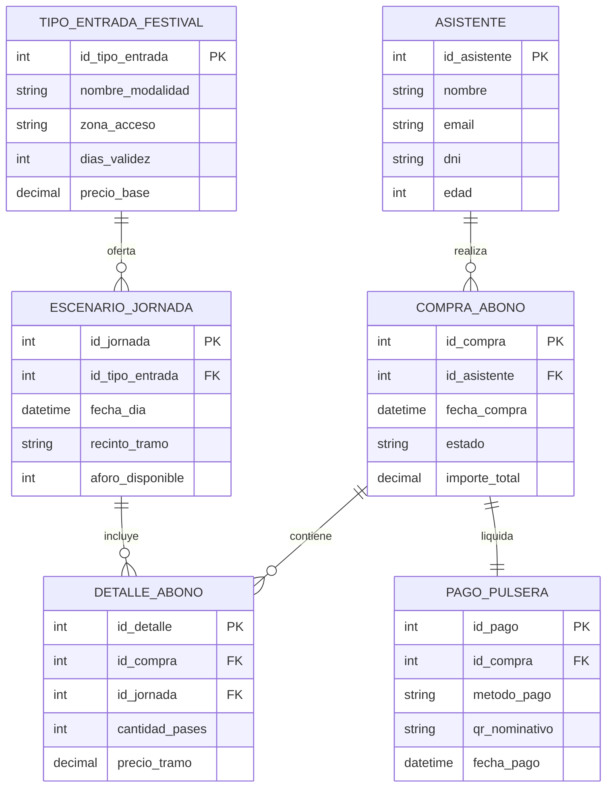

---

## 🏨 8. Reserva en Hotel Rural / Camping

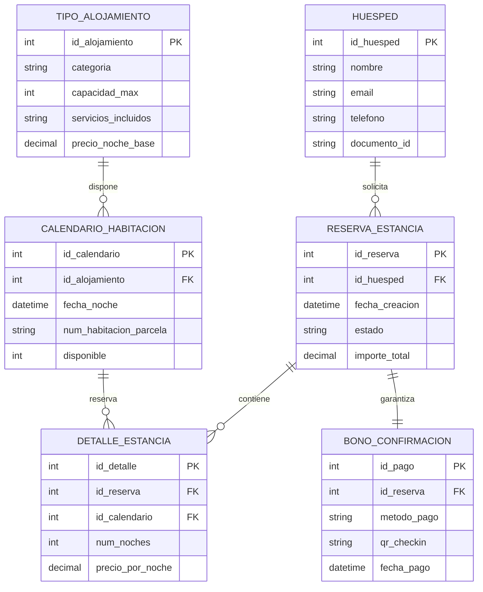

---

## 📚 9. Préstamo de Libros / Material Escolar

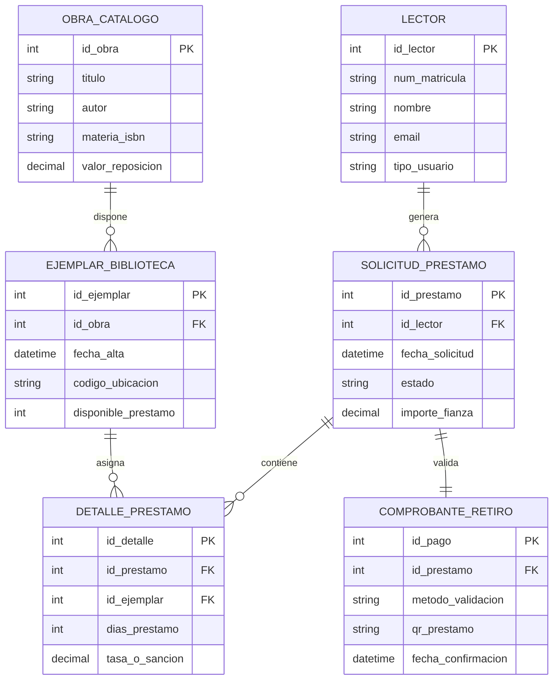

---

## 🗺️ 10. Tours y Excursiones Turísticas

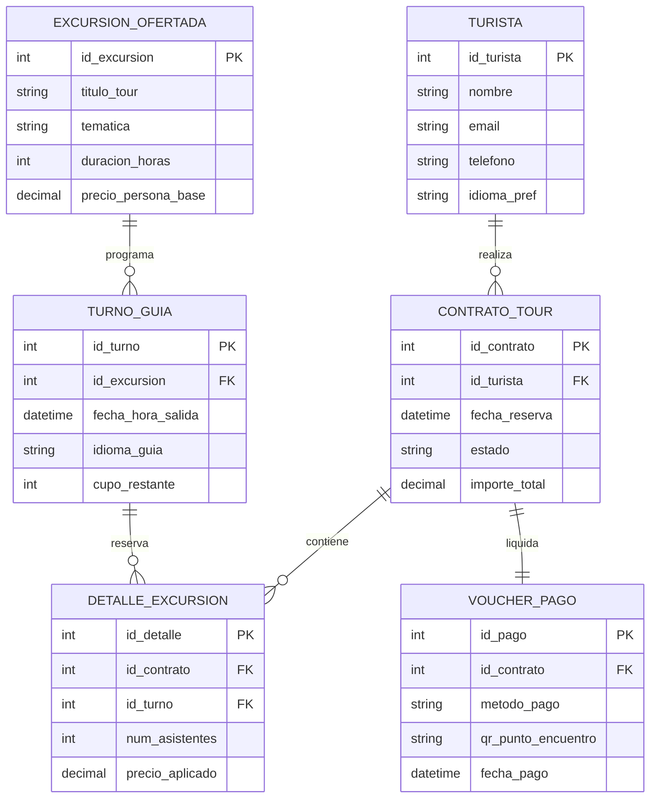

---

## 🏋️ 11. Reserva de Clases en Gimnasio

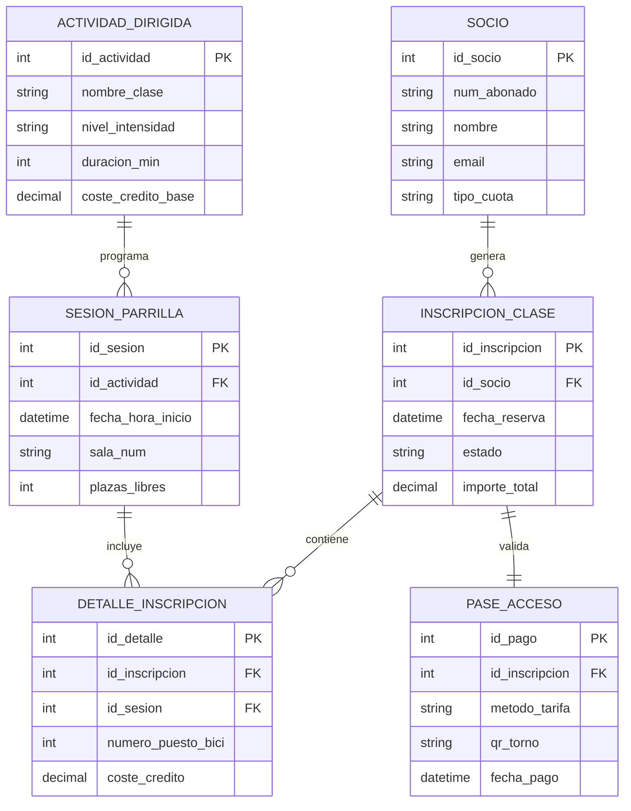